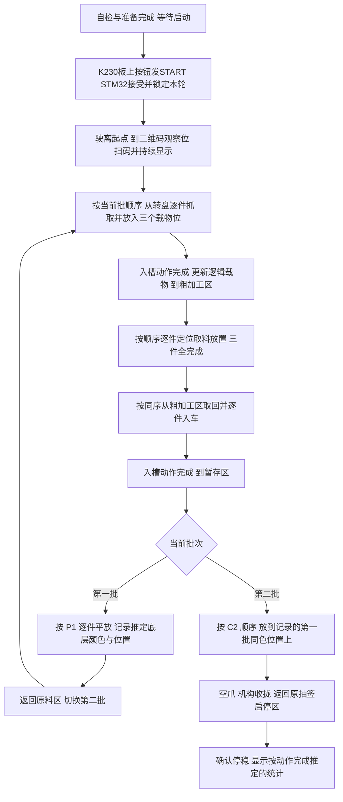

# 智能搬运小车：行为层总计划书

创建日期：2026-10-22；更新日期：2026-10-23。适用工程：`E:/工创赛/迁移野火板`，main 基线 `e04f31d`。

**状态：分阶段规划；实现状态以 README 为准。** [README](../README.md) 记录当前事实；本文说明后续应做什么、为何需要、如何验收。此前标为过时的计划/交付书继续只供参考。本轮不改运行代码，不恢复四轮上电测试，不提交或烧录固件。

**2026-10-27 更新：目标分支选择性加入双舵机及比赛纯调度框架，K230通信未合入；框架尚未注册执行器，不能发车。上电顺序确定为6→5→7轴回零成功后输出舵机初始脉宽；计数遵循第8节12次抓取/12次放置口径。**

## 1. 目标、现有基础与新增确认

目标是从外设联调程序逐步形成可完成初赛两批搬运的自主行为系统：一键出发、扫码、依序取料入车、粗加工区放下并取回、暂存区平放/同色码垛、返回原启停区、显示按动作完成推定的抓放计数。先实现可检查的小闭环，再连接全流程，不一次重写主程序。

| 已有基础/用户决定 | 本计划采用方式 |
|---|---|
| F429＋7 电机；1～4 麦轮，5 旋转臂，6 升降，7 前后微调 | F429 负责运动、机构、行为与故障处理；保持现有 MotorBus 唯一发送者 |
| 扫码已实测；电机已做双节点同时接入、先后 move | 可进入行为接口开发；不推定四轮速度聚合、同步或七机实测完成 |
| 光流、陀螺测试完成并有修正提交 | 先补尺度、轴向、误差验收，再用于运动闭环 |
| `251055f`：光流 SPI 超时改为 2 ms | 保留当前修复，重新量化整机运行时采样间隔 |
| `e04f31d`：gyro 固定补偿 15.86°/s，上电四轮测试关闭 | 当前只能使用此陀螺，按有误差的相对测量使用；不要求先更换模块才推进，也不宣称真实 CAL/精度已通过 |
| K230 基础模型训练完，可识别物料、圆环/数字、障碍物，输出图像坐标 | 经 USART1 PA9/PA10 接 F429；串口协议未实现，图像坐标不能直接当 mm |
| 每次上电自动机构回零，准备完成后等待 K230 板上按钮触发 START | STM32 管任务和动作，K230 管视觉及启动；两端 READY、起点配置与启动复核已确认，见第 1.1 节；回零轴顺序/限位参数待定 |
| 三个独立载物位，一趟带三个 | 首版以三槽装满后跨区为主流程，槽位与颜色/批次绑定 |
| 两个 270° PWM 舵机，型号/职责未定；机构限位等未定 | 先确定执行条件与动作时间，不假定某个舵机一定负责夹爪或料盘 |
| 抓住、入槽、释放不反馈，动作程序正常结束默认成功 | 首版用逻辑载物状态；不做抓取失败或空载对心超时处理，不做 K230 比赛中断连/重启恢复 |
| 放置采用空夹爪圆与目标圆对心，摄像头随臂且视轴对齐夹爪圆心 | 对心后锁住底盘；回车取料、返回记录姿态、垂直放置，详见第 7 节 |

### 1.1 已确认的启动与任务交互（2026-10-23）

已确定的启动链为：**K230 板上按钮 → USART1 START 指令 → STM32 任务状态机**。K230 不是整场任务管理者，不直接绕过 STM32 操纵电机。上电等待期间持续通信、采样、显示与故障处理，不使用阻塞串口等待；没有收到有效 START 不开始搬运任务。

生命周期按已确认流程细化为 `INITIALIZING → HOMING → PREPARING → READY_WAIT_START → RUNNING → FINISHED/ABORTED`。每次上电初始化后自动进入机构回零；回零及必要准备完成后才报告 READY 并等待 START。自动回零属于赛前准备，不需要先收到比赛 START，也不等于四轮上电运动测试。

具体哪些轴参与、回零顺序、限位极性、退让/复查距离、速度和超时须按机械结构确定，不能直接假设 5/6/7 同时向限位运动。回零失败或参考位置不可信时保持未就绪并报告原因；不得将单纯发完命令视为回零完成。准备阶段维持出发包络，不提前执行只能出发后进行的展开。该自动回零流程尚未落地，本次仅记录需求。

| 决策 | 用户已确认的首版范围 |
|---|---|
| 启动入口 | 已确认使用 K230 板上按钮；需做按下边沿/去抖并明确“启动”标识 |
| 主任务归属 | 已确认 STM32 管任务/动作，K230 提供视觉并发送启动 |
| 准备/回零时机 | 已确认每次上电自动回零，准备完成后等待 START；具体轴顺序、限位/避碰及超时参数待定 |
| 未 READY 收到 START | K230 先确认 STM32 READY 再允许发送；STM32 仍复核，拒绝时回报原因 |
| 起点 1/2 与朝向 | 随 K230 发出的 READY 一并告诉 STM32；初始朝向单位、参考方向/枚举在协议阶段确定 |
| K230 断连/重启 | 首版不考虑比赛中这两种情形，不实现重连续跑 |
| 视觉任务派发 | 每当需要 K230，STM32 告知当前阶段与要执行的任务代码，K230 返回对应观察结果 |
| 抓住/入槽/释放确认 | 不做物料结果反馈，动作程序正常执行完成即默认成功 |
| 抓取失败/空载对心超时 | 首版不考虑检测后的处理、重试或回退；不把超时解释成对心成功 |

为避免 READY 双向含义混淆，本文暂命名 `K230_READY{start_zone, initial_heading}`（配置就绪）和 `STM32_READY{ready, reason, config_id}`（执行就绪）。这些是拟议字段，不是现有协议。K230 可在 STM32 初始化/回零期间发送配置；STM32 接收并校验后，结合本机准备状态报告 READY。K230 确认与当前配置对应的 READY 后才允许按钮发 START；STM32 再核查，回报 ACCEPTED/REJECTED 和原因。未就绪的 START 建议直接拒绝、不缓存到稍后自动启动；配置改变时应重新确认 READY，运行后锁定本轮起点与朝向。

启动协议建议用 run_id、command_id 去重：同一已接受 START 重传只重发结果，不重新出发、不清任务码、不重置计时。比赛运行后再次按键不能隐式重新开始；下一轮清理必须在本轮结束后经明确准备流程执行。首版不增加心跳失联状态机或 K230 重启后的恢复握手。

STM32 READY 的前置条件包括配置已接收、协议匹配、必要电机/传感器可用、无 STOP UNCONF、机构回零完成，以及逻辑槽位初始化。首版不以物料检测信号作为就绪前提。当前 gyro 固定补偿模式不能仅凭 calibrated 位当作正常 CAL 合格；其使用误差仍需实测。

“默认成功”应用于抓放动作序列正常结束后的物料状态和统计，不应用于命令刚入队、明确的电机失败或未完成回零。正常空载对心仍须达到圆心误差门槛才进入取料；首版不实现始终无法收敛时的超时退出/补救，也不承诺该场景能完成比赛。既有电机反馈、停车确认/重试和底层故障门控保留。

本轮扫码结果建议在比赛扫码阶段新建会话后锁定，不沿用上电调试时偶然扫到的旧码。启动重传不得清空已锁定任务；“下一轮”与“重传本轮启动”是不同事件。上述协议细节为后续实施建议，不代表已有实现。

## 2. 赛题依据与必须落实的行为约束

已读取本地三份 PDF 的智能搬运部分，并渲染核对场地图、圆环尺寸及评分页。下表页码均为 **PDF 页序号，从 1 开始**；这里只采用本地版本，不代表核验了后续赛事补充通知。

| 来源 | 使用范围 |
|---|---|
| [命题.pdf](../../官方文件/命题.pdf) | 第 1～9 页：作品要求、场地、物料、任务码、两批流程、决赛边界 |
| [评分细则.pdf](../../官方文件/评分细则.pdf) | 第 1～4 页：计分、时间、越界/触碰/放置规则 |
| [赛题解析.pdf](../../官方文件/赛题解析.pdf) | 第 3～25 页：功能、持续显示、场地图、转盘、运行与统计解释 |

| 官方要求 | 对程序/机构的直接影响 | 依据 |
|---|---|---|
| 每轮调试 3 min、运行 3 min；两轮取最好成绩 | 设计 180 s 运行预算，轮次独立初始化；调试模式与比赛模式分开 | 评分 p3；命题 p8 |
| 明确标识的一键启动；开始后不能再触碰机器人/笔记本或遥控 | 上电待机，启动事件只接受一次；比赛中不依赖人点 CAL、ZERO、RESCAN 或上位机按钮 | 命题 p7；评分 p3；解析 p25 |
| 2400×2400 mm；中间十字车道宽 400 mm；出发点二选一 | 地图/起点参数化，导航约束车体投影，而非只看中心点 | 命题 p3；解析 p11 |
| 离开启停区后非机械臂的铅垂投影不得越出车道；障碍数量/位置随机 | 感知障碍、检查完整足迹和转弯扫掠区域，不能写死无遮挡路线 | 命题 p3；评分 p3 |
| 原料区/二维码板位置在范围内随机、区域摆放有误差 | 路径只到观察位，最终靠感知确认，不按地图常量直接抓/放 | 命题 p3、p6 |
| 转盘可双向，6～10 s/圈，停留时长/次数现场确定 | 等待目标可抓窗口；不按固定延时猜物料到达 | 命题 p4；解析 p12 |
| 依任务顺序，每次抓一个，放到车上后才能抓下一个；夹持物不能跨区运送 | 完成入槽与撤爪动作后才离站；首版按动作推定载物状态，实际符合性由实物验收核对 | 命题 p7～8；解析 p19 |
| 第一批三件全部放到粗加工区后，再按顺序取回 | 设整批放置完成屏障，禁止“放一件立即取一件” | 命题 p7；解析 p22 |
| 第一批暂存平放；第二批在第一批同色物料上码垛，且底层须放对 | 按颜色反查第一批位置并使用对应顶面高度；首版不做放后有效性反馈，规则要求不因此改变 | 命题 p8；评分 p3 |
| 物料底面触地即确定放置，不得推行/挪动纠偏 | 对心只能在接触前做；接触后不执行横向纠偏或再拿起重摆 | 评分 p3 |
| 停止运行 15 s；等待转盘增加 8 s；解析写“15秒没有移动” | 设置真实行为进展/车体停留计时；转盘等待单独记录，具体解释须赛前确认，不能靠刷新屏幕续时 | 评分 p3；解析 p25 |
| 上部无遮挡亮光显示任务码与完成信息，字高≥12 mm；解析要求始终显示任务码 | 新增比赛显示页，任务码保持常驻；现有调试页切换与 Font24 不自动满足要求 | 命题 p2；解析 p10 |
| 出发包络≤300×300×400 mm，含软线；出发后才可展开；一个内置电源 | 折叠/展开状态纳入准备检查；不能在启停区抢先展开 | 命题 p2 |
| 能力列表包含无线通信；允许与电脑通信但禁止遥控 | K230 与 F429 的内部有线连接可保留；它不能证明无线能力已具备，另列规则/配置核对项 | 命题 p1～2；解析 p9 |

放置后禁止移动与粗加工区按流程取回需要区分：本计划仅允许“本批三件全放完后、进入正式取回阶段”的正常竖直拾取，不允许为了修正环数而重摆。该边界及“停止运行/没有移动”的认定应向赛项裁判确认，未确认时按保守流程运行；不要以无意义抖动规避规则。

初赛先实现原料、粗加工、暂存及返回。决赛任务、布局和物料会现场发布，保留任务/站点配置能力，不预写不存在的精加工/成品任务。

## 3. 任务码展开与两批总流程

`C1+P1+C2+P2`：C1/C2 是各批颜色及顺序，P1 是第一批粗加工和暂存位置，P2 **只给第二批粗加工位置**。颜色：1 红、2 黄、3 蓝、4 绿、5 黑、6 浅蓝。

解析后建立不可变 TaskPlan：`batch[b].item[i] = {color, order, rough_slot, storage_slot}`。第一批 `storage_slot=P1[i]`；第二批通过颜色在 C1 中查找 j，得到 `storage_slot=P1[j]`，不能用 P2[i] 代替。所有站点位置号必须经现场识别映射，不把图中左右顺序硬编码为 1/2/3。

例：官方任务码 `156+123+516+231`：

| 批次/顺序 | 颜色 | 粗加工位置 | 暂存位置/层 |
|---|---|---|---|
| 一/1 | 红 1 | 1 | 1，下层 |
| 一/2 | 黑 5 | 2 | 2，下层 |
| 一/3 | 浅蓝 6 | 3 | 3，下层 |
| 二/1 | 黑 5 | 2 | 2，上层 |
| 二/2 | 红 1 | 3 | 1，上层 |
| 二/3 | 浅蓝 6 | 1 | 3，上层 |

一件料的逻辑身份为 batch＋order＋color。三槽用独立占用记录，完整入槽动作序列正常结束后推定已载入。每批三件粗加工放置序列都完成后才进入取回阶段。首版不检测空抓或掉料；已知的电机执行失败仍不能当作正常序列结束。

## 4. 行为层结构：小步加入现有主循环

保留 HAL、Keil、现有 UART5/扫码/光流/gyro 服务和协作式主循环。新增独立状态机，QrApp 只作调度与模式仲裁；不把整场比赛写成含 HAL_Delay 的长函数，不另建七份电机服务。

| 层/建议模块 | 输入与职责 | 输出及边界 |
|---|---|---|
| `vision_link` | USART1 分帧、版本、CRC、序号、时效；配置/执行 READY、START、视觉阶段和任务代码 | 带请求/姿态关联的观察快照；不直接驱动电机；首版无断连重启恢复 |
| `perception` | 颜色/编号/障碍、圆心及拟合质量、目标跟踪 | 目标身份、可用性、图像误差；没有有效观察即 UNKNOWN |
| `localization` / `chassis` | 光流尺度/轴向、gyro 相对角、可用的视觉站点参考；麦轮解算 | 车体位姿质量、vx/vy/wz 及统一四轮 RPM 请求 |
| `mechanism` / `cargo` | 5/6/7 轴位置/限位、舵机动作序列 | 机构姿态及执行结果；三槽/持物状态按序列完成推定，无物料结果反馈 |
| `action` | Scan、Navigate、AlignEmpty、PickToCargo、PlaceFromCargo、Home、Return | IDLE/RUNNING/SUCCESS/FAILED/CANCELLED；开始仅提交一次 |
| `mission` / `task_plan` | 起点、任务码、当前批次/序号、前置条件 | 决定下一动作；全局时间、流程屏障、一次启动 |
| `match_ui` / `event_log` | 正常动作完成事件与任务状态 | 常驻任务码、推定抓放计数、剩余时间、故障；不反向触发运动 |

每个动作具有 request_id、当前子状态、目标身份、前置条件、完成条件和取消方法；执行超时按已实现的底层动作能力处理，首版不额外增加空载对心超时分支。每轮 Process 有界返回。API 入队成功或发送 ACK 不等于电机到位；电机执行完成与必要的舵机动作时间结束后，按用户决定推定抓放成功，日志不将其描述为物料检测结果。

比赛中 `mission` 持有运动控制权，调试 UI/串口不再成为第二个运动生产者。故障停止优先级最高，取消同时清理尚未执行的行为意图，并等待停车证据；不能失败后下一轮又重新发运动。比赛终止为锁存状态，赛后显式开始下一轮才重置。

## 5. 第一阶段优先接通 K230，协议先传观察再做动作

用户已选 USART1，协议尚未实现。建议初版沿用当前 115200/8N1，先传结构化结果，不传整帧图片；若实测带宽不足再调整。当前 printf 与 USART1 共用，实施时必须改为独立调试出口、禁用文本打印或统一封装日志，不能把裸文本插进二进制帧。

建议帧头＋协议版本＋消息类型＋有界长度＋会话/序号＋载荷＋CRC16。具体字段字节序、CRC 参数、最大目标数和超时在接入任务中一次确定并给出样例；不把本文建议格式写成已实现协议。

| 方向/消息 | 必要内容 |
|---|---|
| K230→STM32 K230_READY | 协议/模型版本、配置编号、抽签启停区 1/2、初始朝向；朝向单位与参考轴须明确 |
| STM32→K230 STM32_READY | 配置编号、执行就绪/未就绪及原因，例如回零未完成、起点配置非法、必要模块未就绪或停车未确认；不增加物料反馈门槛 |
| K230→STM32 START / STM32→K230 RESULT | run_id/command_id、对应配置、接受或拒绝及原因；K230 先看 READY，STM32 再复核；重复 START 不重复执行任务 |
| STM32→K230 VISION_TASK | request_id、stage_code、task_code、目标颜色/圆环号、相机姿态代号、pose_epoch、ROI/目标层；每次需要视觉时明确告诉 K230 当前阶段和要做什么 |
| K230→F429 OBSERVATION | 对应请求/姿态代号、帧序号、图像尺寸、坐标原点、目标类别/ID、框/圆心、置信度、检测到/未检测到、采集时间/处理延迟 |
| 对心观察扩展 | 同一帧夹爪轮廓圆/椭圆、目标同心圆组、各拟合残差/遮挡标志、中心差；不能只返回一个无质量说明的误差值 |
| F429→K230 STATUS | 当前批次/目标、机构状态、是否允许采集/微调、故障；作为关联，不让 K230 直接发送电机帧 |

先以 10～20 Hz 观察结果作为调试候选，目标数/帧长由带宽核算确定；例如 20 Hz×128 B≈2.56 kB/s，115200/8N1 理论字节率约 11.52 kB/s，还需留双向、突发和日志余量。这是预算，不是实测吞吐保证。

建议阶段名包括 NAVIGATE、RAW_PICK、ROUGH_PLACE、ROUGH_PICK、STORAGE_PLACE；任务名包括 FIND_MATERIAL、FIND_RING_NUMBER、ALIGN_EMPTY_CIRCLES、DETECT_OBSTACLE。具体数值编码与识别输出由双方协议统一，以上仅为建议名称。阶段决定用途，任务代码决定本次识别内容；K230 不自行推进批次。首版不发送抓后/入槽后/释放后检查任务。

从开源视觉程序的模式/上报分离得到一个适合本车的协议细化建议：`VISION_TASK` 除阶段和任务外，还带 `report_policy`。到站找编号/目标时单次取样；空载对心时在该阶段持续返回新帧，离开对心阶段即停止上报并清除上一阶段结果。K230 切换任务时清掉前一任务的跟踪历史；STM32 只接受匹配当前 request_id、pose_epoch、目标编号的结果。这属于前置视觉请求的有效性管理，不增加抓后、入槽后或放后结果反馈。

两端时钟未同步时不能直接相减判年龄。初版可用请求到回复的 F429 时间上界、接收时刻、帧序号和 K230 报告的处理延迟联合拒绝旧帧；机械臂运动后增加 pose_epoch，旧姿态图像不能闭环，重复帧不累计稳定次数。只用新鲜有效观察更新微调意图；这属于数据有效性检查，首版不增加 K230 失联检测、重启恢复或抓取/对心失败重试流程。

验收先不运动：验证带起点/朝向的 READY、准备未完成拒绝 START、准备完成接受 START、重复 START 去重、阶段/任务切换与结果归属，以及分包粘包、CRC 错误、空目标和旧帧/错误姿态。K230 断连/重启恢复不作为首版交付要求。模型训练完成不等于相机标定或场地识别率已经完成。

## 6. 移动、姿态和机构基础行为

### 6.1 麦轮及定位

先测轮径、轮距、轴距、减速比、滚子布置和四轮正转方向，统一车体 x 前/y 左/角度逆时针等约定，并验证轮速映射。提供 `SetBodyVelocity`、短段 `MoveRelative`、`RotateRelative`、`StopAndConfirm`，限速、限加速度和速度租约都由同一处管理。

低层已有四轮速度包，尚无车体解算；先实测四轮同转、前后/横移/正反转和停止，再做短段闭环。首版速度向量发布可从 10 Hz 起步，控制计算可更快，但不能无界向 UART 排队。当前约 500 ms 的电机字段轮询和 1600 ms 新鲜度是通信诊断参数，不直接作为精定位闭环允许的测量年龄；行为层根据实测停距/延迟设置更严格的用途门槛。

光流需要已知距离的正反向/横向重复标定、安装高度及轴映射。传感器离车体旋转中心的偏置会把转动计入平移，需标定安装位置并补偿，或先限制为小转角分段运动。图像、光流、gyro 不同时有效时，显式降低位姿质量，不用旧有效位维持导航。

底盘的同一组 `vx/vy/wz` 请求应只由一个控制器合成：导航给车体平移目标，短段航向保持给角速度修正，视觉对心阶段再由对心动作接管平移。参考工程把逆运动学目标和实际轮速分别留作诊断，本车也应能区分“上层速度目标在变”与“轮子跟不上”。参考实现的速度量是 RPM 等效量，本车须先标定轮径与安装方向，再定义真实车体单位，不能套用其 PID 符号或常数。

当前 gyro 固定补偿可继续支持联调。先在静止、预热、不同载荷振动条件记录残余速率及 10/30/60 s 漂移，再用已知角度/视觉参考验证短段转向。固定偏置不是物理静止证明；ZERO 不能消除残余速率。可规划有静止证据的受控偏置更新，但不得移动中自适应吞掉慢转，也不直接全面放宽 CAL 门限。若短段误差仍不达标，优先缩短无参考行程、在可观测站点用视觉纠偏或保持朝向横移；缺乏可观测参考时停留/结束，不假称全局航向可靠。

地图采用灰色车道连通图＋站点观察位＋局部对准位＋障碍占用；边/点坐标都可配置。相机随臂，导航时必须回到已标定的观察姿态，不能把取料姿态图像直接投到导航平面。相机看不到行驶方向时不得假定前方空旷。

车体接近 300×300 mm 时，45° 原地转动的横向投影约为 424 mm，大于 400 mm 中央车道；这是几何示例，实际按实测包络检查。因此优先利用麦轮保持朝向横移/纵移，仅在扫掠足迹允许处旋转。障碍按车体足迹和误差余量膨胀，无法通过时选择其它合法通路，不挤入黄色区。

### 6.2 机构、舵机与三槽

先确定限位类型/引脚、零点方向、行程和每轴单位换算，再建立 5/6/7 轴回零/位置动作。定义收拢、转盘观察、抓取、各载物槽、放置悬停、避让高度等命名姿态；具体数值来自标定，不使用厂家演示参数代替机械参数。

首版采用顺序联锁：先到允许旋转的升降/伸缩区域，再转臂，再下降/伸出；升降停车保持原有不自动失能策略。未经碰撞包络验证，不为节省时间把三轴同时运动。无真实限位/原点时只能运行受控台架范围，不能宣布自动回零完成。

回零建议按每轴非阻塞状态机实现：先判开关上电是否已触发；若触发，先退离并确认释放；再寻限位、停稳、退离、低速再接近，最后建立零点。去抖次数、正反方向、最大运动量、轴间避碰顺序须用本车实物确定。参考工程的“到时发送停止”不能替代本工程 MotorBus 的新鲜零速/状态确认，也不能另建一个电机串口发送者。

每槽记录 EMPTY/RESERVED/LOADED，以及 batch、order、color；夹爪记录逻辑 EMPTY/HOLDING。正常抓取序列结束置 HOLDING，正常入槽序列结束置槽位 LOADED、夹爪 EMPTY；回槽取料后清对应槽位。这里的状态均为流程推定，不增加视觉、开关或电流式物料确认。电机位置动作仍等待其执行完成；无反馈舵机按标定动作时间推进，具体舵机职责和时间待定。明确的底层错误走执行失败路径，不提交物料成功事件。

## 7. 核心放置方案：空载两圆对心，回车取料，再返回放置

### 7.1 用户已确认的动作原理

物料抓取边缘为圆；夹爪闭合轮廓设计为同尺寸圆。摄像头随机械臂/夹爪运动，视轴对齐夹爪轮廓圆心。先将空夹爪转到放置固定姿态，视觉同时定位夹爪轮廓圆和目标同心圆，底盘与机构微调；达到可接受圆心距后，**底盘保持不动**，5 号轴转到车上槽位取料，再回到记录的旋转位置，6/7 号轴恢复对应姿态，垂直放下。目标仍是在时间预算内对心，但按最新决定首版不实现对心超时处理。

该方案作为首版主流程，不改成“先抓料再寻找圆环”。以下控制分配和阈值属于拟议实现，尚未验证；首版没有抓后确认或放后复核。

### 7.2 对心动作状态机

| 子状态 | 执行内容 | 正常转移条件 |
|---|---|---|
| PRECHECK | 核对批次/颜色/圆环编号、逻辑槽位和空爪记录、机构已回零、底盘定位质量 | 采用逻辑载物记录，不等候物料确认信号 |
| EMPTY_VIEW | 空爪闭合到规定轮廓，升至标定悬停高度，5 号轴到观察角，7 号轴留调节余量 | 位姿稳定后更新 pose_epoch，请求新图像 |
| ACQUIRE | 请求 K230 同帧检出夹爪轮廓与正确目标；第二层目标对应记录的同色底层 | 有可用的新图像才进入微调；无效观察不用于运动，没有首版超时回退 |
| ALIGN | 限速、限范围微调底盘/机械臂，持续核对图像年龄和关节状态 | 误差收敛且连续多帧稳定；首版无超时成功、降门槛或失败重试分支 |
| FREEZE | 停车并确认新鲜零速；保存旋转角/升降/伸缩目标、相机姿态、目标ID、底层高度及观测版本 | 未确认停稳不记录完成；位置保存不是只记屏幕坐标 |
| FETCH | 底盘保持不动；按避碰姿态回指定车载槽，执行抓取及抬升序列 | 序列正常结束推定已抓住；不检测空抓，不把内部取料计作新的赛题抓取 |
| RETURN | 5 号回到保存姿态，6/7 号按避碰顺序恢复到载料悬停姿态 | 比较反馈与目标、检查底盘漂移；ACK 不够 |
| DESCEND_RELEASE | 返回目标姿态后沿标定垂直方向下降到本层放置高度，执行松爪 | 位置动作及舵机规定时间结束后推进；不等待释放反馈，下降放置阶段禁止横向纠偏 |
| RETRACT_COMPLETE | 垂直撤离，更新逻辑持物/槽位并提交一次放置事件 | 序列正常结束默认成功，不检查偏位、倾倒或掉落 |

保存的是可重复的**末端目标**，不要求每次恢复过程中按同一危险顺序穿过障碍。空载定位高度、载料悬停高度、触地高度分开；不同批次/地面层/码垛层不能共用一个 Z 值。第二层目标是第一批同色物料的实际顶面中心，不能只对齐地面圆环中心。

### 7.3 图像到微调，避免两套控制相互打架

误差可先表示为 `e=(u_target-u_tool, v_target-v_tool)`，但像素差不是毫米。对已知观察姿态/高度做相机畸变与平面/手眼标定，建立小位移到图像变化的局部映射；旋臂改变相机朝向后，映射也随姿态变化。两圆不在同一高度，斜视时透视/视差使图像圆心重合不必然意味着落点同心；投影为椭圆时应标定/校正拟合中心，而非强行用正圆检测。

首版建议分阶段分配：底盘负责两方向粗对准，5 号旋转保持标定角或只作受控小角调整，7 号负责其可控方向的最后微调，6 号保持观察高度。最后阶段再根据实测局部映射允许协调小步调整；由一个 Align 控制器统一分配剩余误差，不能底盘与机械臂各自追同一误差、重复补偿。7 号约 50 mm 微调需求尚无行程标定，到软限位应先回中并重新规划底盘位置。

对心完成需同时满足：正确目标身份、两轮廓质量、误差阈值、低误差变化率、连续若干新帧、速度接近零、无触限/停车未知。连续帧数、像素/mm 阈值、速度由实测确定；示例可用 3～5 个新帧作起点，但不是竞赛验收数值。同一重复帧不能累计稳定次数。记录对心用时供优化，首版不实现超时退出/重试。

底盘冻结期间保持监测轮速、光流和可用视觉基准。电机零速不代表地面绝无滑移；机械臂转动、载荷变化可能引起车身轻移。超过保存误差预算则该对心结果作废；用户正常流程仍保持底盘不动，不能在回车取料阶段悄悄用底盘“补偿”导致姿态基准失配。

首版载料返回后按保存姿态与标定高度继续下降，不增加持物视觉复核或退回载物位重新对心的回退流程。机构返回反馈仍须满足动作完成条件；空载到载料的偏差靠开发阶段的重复性测量与标定处理。

### 7.4 必须先做的重复性试验

1. 空夹爪固定姿态：测工具圆心到真实垂直落点的偏差，确认抓取边缘圆心与物料底面/支撑面中心的关系，不由“抓取边缘为圆”推定底面同心。
2. 从每个载物槽返回放置姿态：空载、各色实物载荷分别重复至少 20 次作为开发起点；测末端 XY/Z、相机中心、底盘位移，报告最大值/分布，不只平均值。
3. 区分旋转传动回差、伸缩/升降回差、夹持偏心和结构挠曲；可采用一致方向接近目标、稳定等待及载荷补偿，但均须测量确认。
4. 测平放与上层码垛的观察高度、遮挡和实际落点；依靠人工记录检验空载对心后载料返回的效果，不将结果反馈检测加入首版运行流程。
5. 正常链路逐步验收：新帧对心、停车、回槽取料、返回、下降、释放、撤离和事件去重；另检查旧帧/错误姿态不驱动微调。空抓检测、掉料检测及对心超时恢复不属于首版通过条件。

命题给最内环外径为物料最大直径＋3 mm；若按理想同心圆投影推算，径向余量仅约 1.5 mm。这只是几何尺度提示，实际计分按环边缘可见性、线宽和物料形状判断，不能直接作为通用放置容差。最终误差预算必须覆盖视觉定位、标定视差、底盘保持、机构返回、夹持偏心与释放滑移；像素误差趋零只覆盖其中一项。

## 8. 抓取、装载、码垛与事件统计

转盘抓取遵循“识别目标颜色/身份→定位可抓窗口→执行抓取→执行入指定槽→撤爪→更新逻辑槽位”。抓住和入槽不做反馈，完整序列正常结束即按成功推进。转盘停止时长未知，正常抓取前仍需视觉定位，不因旧目标坐标直接下爪；首版不做抓取失败检测或重试。

参考视觉项目把转盘识别分成“曾经转动”和“当前位置连续低速稳定”两项证据。本车可让 K230 在抓取前报告 `target_color`、抓取坐标、frame_id 和 `pick_window_ready`；STM32 只有颜色/坐标匹配且抓取窗口已就绪才开始既定抓取序列。该信号只说明抓取时机，不是抓住物料后的结果反馈，也不引入空抓失败处理。具体阈值与转盘实际转速、停留窗口一起标定。

粗加工取回先核对该批三个放置序列已全部完成、当前顺序，再视觉定位目标并竖直拾起，不能推行移动物料。三个入槽序列完成、逻辑夹爪为空、机构回到运输包络后离站，不等待槽位传感器。

第一批暂存放置序列结束后建立 `base[color]={slot, target_pose, support_height, placed_assumed}`。第二批按 C2 顺序查同色 base，并以对应层的中心/高度完成正常定位和放置。首版没有底层放后有效性检查或码垛后的稳定性反馈；该映射代表已执行的预期位置，不代表检测到的实际成功。

事件日志使用 `{run_id,batch,item,stage,event_id,basis}` 去重，抓放事件 basis 记录为动作序列完成推定。重复回包、状态机再次轮询和重绘不增加计数。完整两批有 12 次外部抓取入车（原料 6、粗加工取回 6）及 12 次对外放置（粗加工 6、暂存 6）；车载槽内取料和空夹爪定位不计入。这里是流程推导，正式显示计数口径需与赛项确认。

首版显示“抓取/放置完成数”，按正常序列完成累计；日志注明推定口径，不使用“物料已检测确认”的描述。实际抓错、空抓或掉料可能不会反映在计数中，软件计数不能直接证明满足官方正确数量要求。正常实物验收仍应人工核对最终物料与显示计数；最终得分由裁判认定。

## 9. 时间、评分与首版异常范围

官方：扫码显示 1 分；每次正确抓取入车 2 分；平放按环号得 15/10/7/5/3/1 分；第二批同色稳定码垛得分同其有效底层；完成全部流程返回 2 分；返回后正确显示抓取/放置数量各 2 分。现场成绩再按最高队伍成绩归一化，初赛权重为命题文档20%＋创意10%＋现场70%（评分 p1～4）。不要把机器人原始动作得分当作最终百分制成绩。

优先级建议：顺序和不越界 → 一批完整闭环 → 两批/同色码垛 → 提高环数 → 压缩时间。第一批暂存精度同时影响本次平放与第二批码垛收益，值得重点优化；但不能为追高环超时或触地后挪料。

180 s 初始设计预算示例（待测，不是承诺）：扫码/起步 8 s、所有跨站行驶含返回 40 s、转盘抓取入槽 30 s、两批粗加工放下/取回 42 s、两批暂存放置 24 s、额外定位观察/机构稳定等待 16 s、余量 20 s。**第 7 节每件放置多了空载对心、回槽取料和返回，必须逐项实测计入粗加工/暂存时间；不可默认能达到表中预算。** 超预算先优化观察位/轨迹/合法动作协调；此预算不意味着首版已包含抓取失败或对心超时恢复。

官方计时从裁判开始指令起算，不因本机按钮稍晚按下而延后。程序不能直接假定按键后还有完整 180 s；须预留起动反应余量，并在赛前明确本机计时与官方计时的关系。自检、机构归零及可行的静止偏置评估尽量在调试/待机完成，启动后不再依赖人工点击。

对于车体停留可能超过 15 s 的站点，按真实物料/圆环位置安排必要的站内转移，或优化机构用时；不要用伪动作刷新计时。评分对转盘等待额外 8 s 的适用方式待确认。记录普通停留、转盘等待和对心用时以便验收；用户已排除首版对心超时处理，不能据此承诺异常等待仍符合比赛时限。比赛整体结束计时与单动作失败恢复是不同职责。

| 情形 | 首版范围 |
|---|---|
| 视觉过期/错误请求/相机姿态不匹配 | 无效帧不更新运动意图，不累计稳定帧；不增加任务级超时重试流程 |
| gyro GAP、光流失效或位姿质量不足 | 停止需要该测量的动作；有已验证视觉参考才可重建定位，不自动 ZERO 当恢复定位 |
| 电机 UNKNOWN/STOP UNCONF/机构限位异常 | 禁止新动作，保持现有停车确认/重试；升降不自动失能 |
| K230 比赛中断连或重启 | 用户明确不考虑；不实现重连、恢复现场或自动续跑 |
| 抓住/入槽/释放结果、空抓、掉料 | 不做结果反馈和失败检测；序列正常结束即推定成功，不增加补救动作 |
| 空载对心超时 | 不实现超时分支、降低阈值、跳步或回退；只有正常收敛条件满足才进入 FETCH |
| 载料返回 | 仍核查机构位置执行完成，底盘保持不动；不增加物料视觉复核或回槽重试 |
| 已放下偏位/倾倒 | 首版不自动识别该结果，不推挪纠偏；由实物验收记录 |
| 时间不足 | 不承诺未完成流程提前返回也有返回奖励；按已知位置/载物状态选择合法停止或可完成的剩余动作 |

## 10. 分阶段实施与每阶段最终效果

所有阶段默认 main、最小改动；每阶段交付源码/配置差异、相应测试、实物操作步骤、实际结果/待验和 README 更新。无需重建 CubeMX 或引入 RTOS。

| 阶段 | 工作范围与依赖 | 可见效果与通过条件 |
|---|---|---|
| P0 基线与误差记录 | 记录双电机测试参数、光流尺度、gyro 残余漂移、机构/槽位/相机尺寸；区分正式/临时宏；补固定偏置模式针对性验证 | 能复现实物状态，知道现有传感误差；不把旧宏关闭的回归当当前默认验证 |
| P1 K230 通信＋任务展开 | 双向不同语义 READY、起点/朝向配置、START 复核与去重、阶段/任务代码、单次/连续上报策略、观察时效/姿态关联、printf 隔离；TaskPlan/颜色反查 | 能显示配置和对应目标；切任务清旧结果；未就绪拒绝 START 并说明原因；就绪接口用测试替身验证但不假报真实回零完成；例码正确展开，无需自动运动 |
| P2 四轮行为与短段定位 | 逐轮方向/参数→四轮速度组→前后横移/转向/停车→有限距离与航向闭环；统一速度目标与轮速诊断 | 四轮实测能重复完成短段运动；漂移/停距有记录；断反馈不续跑 |
| P3 机构、三槽与回零 | 限位/零点、上电已触限退离＋再接近、5/6/7 单轴与姿态联锁、舵机职责/动作时间、逻辑槽位 | 每次上电自动回零并等待 START；正常三槽取放与返回姿态可人工核对，升降保持验证；不添加物料结果反馈 |
| P4 两圆对心放置专项 | 依赖 P1/P2/P3；空爪标定、微调、冻结、回槽取料、返回、按标定高度下降/释放/撤离 | 单件正常放置重复性通过，人工记录实际落点；旧帧不驱动微调；无抓后/放后检查或对心超时恢复，不触地后纠偏 |
| P5 站点与合法导航 | 起点1/2、二维码/转盘/粗加工/暂存观察位、障碍与足迹约束；相机姿态调度 | 两个起点均能沿合法车道到站/返回；随机障碍有明确绕行或停止结果 |
| P6 一批端到端 | 扫码→转盘运动/低速窗口判定→三件入车→粗加工三件全放完→顺序取回→暂存平放；整批屏障/事件去重 | 无人工操作完成第一批；动作顺序/逻辑槽位/推定计数一致；实际物料结果由人工验收记录 |
| P7 两批＋码垛＋返回 | 第二批颜色反查、记录的底层位置/高度、载荷影响、时间预算 | 正常场景同色码垛并返回原启停区；人工核对稳定性与计数，不宣称已具备结果检测 |
| P8 比赛模式与联合验收 | 一键锁定、常驻任务码、终止/复位、180 s、日志；验证已纳入范围的启动拒绝、帧校验和底层故障门控 | 两轮独立运行不依赖电脑操作；调试模式不能抢控；不要求 K230 断连恢复、空抓检测或对心超时恢复 |

建议下一对话先实施 **P1**，同时把 P0 的实测参数作为输入记录；P2/P3 物理调试必须等所需参数/限位确定。P4 是本车方案的关键实物关口，应在整场路线编排前证明可重复，避免全流程写完才发现空载定位不能在载料返回后保持。

## 11. 比赛显示、通信边界与验收记录

比赛页面在扫码后始终保留四组任务码，同时显示按动作序列完成累计的抓取/放置数、当前批次和结束状态；调试页不得覆盖常驻区域。日志记录计数为流程推定。4.3 寸 480×272 若按标称有效尺寸估算，12 mm 字高约需 61 像素，现有 24 像素字体明显不能据此宣称合格；应实测有效显示区/实际字形高度，采用两行任务码等布局并保持分步绘制，最终用尺验收，而非只改字体名。

K230 随车参与自主感知，USART1 内部链路不是笔记本遥控。笔记本仅做被动记录/赛前配置，比赛中不触碰、不下发人工控制。无线能力要求仍另行核对，不将内部 USART1 描述为无线通信完成。

每次实物验收记录：代码提交/宏、场地/起点、传感安装、相机分辨率/曝光与模型版本、目标/任务码、三槽载荷、动作起止和接触时刻、识别年龄、误差/漂移、失败原因、最终物料状态及视频。优先记录最大误差与异常样本，不只保留成功视频。

主机测试验证起点配置、双向 READY、START 复核/去重、阶段任务匹配、任务映射、正常动作顺序、逻辑槽位、旧帧和停止优先；Keil 构建验证工程；实物重复性和整场时序独立验收。人工检查实际物料结果属于开发验收，不要求把该反馈加入首版程序。被排除的失败恢复不列为首版测试通过项。

## 12. 当前待确定项与交接

不再重复询问已明确的 F429/七轴、K230/USART1、三槽、随臂同轴相机、底盘冻结及第 1.1 节八项流程决定。后续实施时重点补齐：初始朝向参考方向/单位及协议消息编码；相机安装/畸变与观察高度、夹爪/物料底面几何；三槽坐标、舵机职责和动作时间；各轴限位/原点/换算及回零顺序；麦轮几何和方向；光流毫米系数；gyro 补偿后的实测误差；对心/返回/释放误差预算；运行停留规则与无线能力的现场要求。首版不再把持物检测、失败重试或断连恢复列为待决策需求。

可交给下一对话的任务：

> 先读工程 README 和本行为层总计划书，在最新 main 最小改动实施 P1：K230 经 USART1 与 F429 通信，K230_READY 携带抽签启停区 1/2 和初始朝向；STM32_READY 回报真实准备状态。K230 确认就绪后才允许板上按钮发 START，STM32 再复核并回报接受/拒绝原因，重复 START 不重复出发。加入 STM32 派发阶段/任务代码、K230 回复图像结果的匹配接口，以及任务码到两批目标的纯逻辑展开。K230 当前输出物料、圆环/数字和障碍的图像坐标，协议未实现。双方约定消息编码、朝向单位/参考方向和测试帧，隔离 USART1 printf，验证拆粘包/CRC/旧帧/姿态、READY/START 和任务切换。首版不做比赛中 K230 断连/重启恢复，不加抓住/入槽/释放反馈或抓取失败/空载对心超时处理；后续抓放按完整动作序列正常结束推定成功。保留 UART5、扫码、光流、gyro、分步 UI 和底层停车策略；四轮上电测试为 0，gyro 固定 15.86°/s 临时补偿为 1，不擅自恢复或假称 CAL 完成。第二批暂存按第一批同色位置映射。本阶段不自动移动或抓放；回零及任务执行未实现时如实报未就绪，用测试替身验证握手，不让实物假报 READY。交付协议、实际显示效果、软件测试及 K230 实物联调结果/待验，更新 README。

### 12.1 本地开源项目复核后的设计取舍（2026-10-23）

以下来自 `E:/工创赛/开源项目` 的源码静态阅读，属于**对本方案的补充建议**，不是本车已实现能力，也没有进行原项目实物复现。优先吸收动作边界、标定方法和接口含义，不复制其引脚、速度常数、限位极性或旧赛题任务码。

| 参考实现与源码 | 对本车的具体启发 | 放入哪一阶段 |
|---|---|---|
| [创源启明视觉主程序](../../开源项目/创源启明/cyqm_vision_gongxun-main/code/main.py)、[协议](../../开源项目/创源启明/cyqm_vision_gongxun-main/code/串口通信协议.md)把识别模式和单次/连续上报分开，切模式会清历史 | `VISION_TASK` 增加上报策略；到站单次采样、对心连续采样，切任务清旧结果。沿用本车 request_id/pose_epoch，不直接照搬其无 CRC 的帧 | P1 |
| [转盘物料检测器](../../开源项目/创源启明/cyqm_vision_gongxun-main/code/material_pickup_detector.py)先确认转动，再累计接近停稳的帧 | 将“目标出现”与“可下爪窗口”分开；只有抓前 `pick_window_ready` 有效才执行抓取。该信号不确认抓后持物 | P1 约定字段，P6 实物标定 |
| [三环检测器](../../开源项目/创源启明/cyqm_vision_gongxun-main/code/ring_station_detector.py)利用三圆几何、椭圆拟合、跨帧稳定性和角度误差 | K230 的基础模型图像坐标还不足以支撑毫米级落点；需增加夹爪圆/目标圆几何拟合及质量字段。工位多圆/线能提供局部朝向参考时才考虑角度修正，不能把像素中心重合直接视为放置成功 | P1 定输出，P4 标定 |
| [一点创绘回零](../../开源项目/2027物流搬运赛道开源方案-一点创绘/程序/抓取和放置测试代码/APP/car_init/car_init.c)处理上电触限、退离、去抖、再寻限位 | 借用状态机步骤来补齐本车上电自动回零的边界；总线发送、停车证据仍由现有 MotorBus 提供 | P3 |
| [一点创绘麦轮控制](../../开源项目/2027物流搬运赛道开源方案-一点创绘/程序/抓取和放置测试代码/APP/mecanum_imu_move/mecanum_imu_move.c)区分上层轮速目标、实际轮速和航向修正 | 保留单一车体速度入口，分别记录目标/反馈，调试视觉微调震荡时能判断是控制指令还是车轮执行造成；正负号和 RPM 等效量需本车实测 | P2/P4 |
| [西安理工主任务](../../开源项目/【工创赛2025-智能物流搬运塔吊方案开源（2分15秒）】西安理工大学工程训练中心/2025智能物流搬运_电控_XAUT_20250811/Logistics_Vehicle_F407_V2.7.4_OpenSource/RTOS_APP/Main_task.c)把区域导航与工位精校分层，[创源启明机械臂控制](../../开源项目/创源启明/rpp_-arm_-public-main/rpp_-arm_-public-main/源码/User/app/move_ctrl.c)把长动作拆成阶段 | 继续使用本车协作式主循环：地图只把车带到观察位，工位使用视觉局部对准；机械臂按可中断的有限步骤推进。参考工程采用 RTOS 或独立机械臂控制器不构成本车必须换框架的理由 | P3/P5 |

**对现方案最值得改的一处**是把视觉输出从“识别到某颜色/某圆的图像坐标”升级为“匹配当前任务的可用观察”：至少包含目标身份、相机姿态、帧号、拟合/稳定质量；转盘另有抓取窗口，空载对心另有两圆中心差。它是抓取前/放置前的定位依据，不增加抓住、入槽或释放后的结果反馈，也不改变用户已确定的空爪对心→底盘冻结→回车取料→返回放置顺序。

### 本地来源指纹

用于识别本次计划所依据的文件，后续规则变更应重新核对：

- 命题.pdf SHA256：`1AC7FA340193591874E3EC84F9427567864C16AB39FB500DB814A4D2CFC000E4`
- 评分细则.pdf SHA256：`5DA7FE1DBC1442B3DEE738E36C979BDDE4F2EAE59C49677B70D4DE69D26F86C7`
- 赛题解析.pdf SHA256：`8037EFB99DBA5185F11B9B0CBA30F71025B77FBA2D3A7F875D6E0FA9AECCD498`
