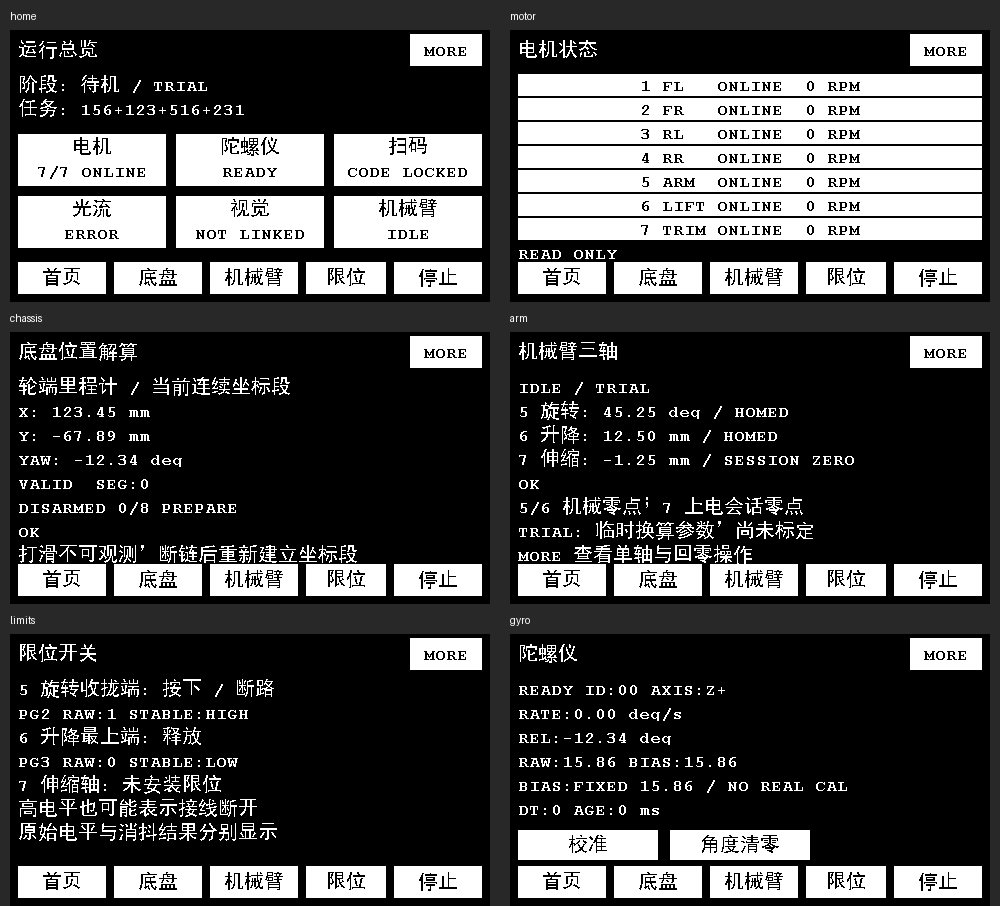

# 2026-10-24 显示界面改版

本次按最新显示需求重做页面组织，当前操作以本文和 README 为准。早期文档中的 QR 默认页、MOTOR 标题跳转、MANUAL/RUN 测试菜单及旧底栏位置已过时。

## 当前界面

开机进入“运行总览”。上部为真实软件运行阶段及任务码，六个模块按钮显示电机、陀螺仪、扫码、光流、视觉和机械臂的简要状态。回零显示当前轴号，底盘八段验收显示当前段号；停车/故障优先展示。比赛状态机与 K230 协议仍未实现，视觉详情和首页 MORE 如实注明，不假报比赛就绪。

所有页面底栏固定为 **首页 / 底盘 / 机械臂 / 限位 / 停止**。模块右上角 **MORE / LESS** 切换详情；无隐藏标题跳转。所有可点击控件均为白色矩形、黑字，背景黑色；动作只在按下边沿触发，按住或滑入按钮不重复触发。

| 页面 | 概览 | MORE |
|---|---|---|
| 首页 | 当前阶段、任务码、六模块状态按钮 | 尚未实现的比赛入口、总线统计、UI 最大单步耗时 |
| 电机 | 七轴在线/过期/运动/故障/停车状态、RPM，点击行进入该轴 | 单轴累计计数、速度、状态、错误、上一轴/下一轴 |
| 陀螺仪 | 角速度、相对角、RAW/BIAS、校准状态、采样时效；校准/角度清零 | ID、采样间隔、GAP、错误与恢复统计 |
| 扫码 | 锁定任务码、串口状态、重新扫码 | 会话、有效/无效/重复帧及错误统计 |
| 光流 | counts、质量、累计清零 | 采样/通信统计、原始质量与故障；仅诊断，不参与底盘控制 |
| 视觉 | K230 通信尚未实现 | USART1 引脚及当前波特率；无伪造视觉结果 |
| 底盘 | 持续后台里程计 X/Y/YAW、VALID/SEG、当前动作段和原因 | 四轮目标/反馈、故障原因、显式“底盘八段验收”按钮 |
| 机械臂 | 5 号角度、6/7 号毫米位置、零点类型及当前状态 | 点击白色轴标题切换 5/6/7、计数、配置、动作状态、重新回零/机构验收 |
| 限位 | PG2/PG3 原始电平与消抖状态，7 号无开关 | NC 高有效接线、最大采样间隔与最后采样年龄 |

电机页删除 MANUAL、原始使能/速度/脉冲 RUN、四轮 0xAA/SYNC 测试模板和单轴/四轮分散停车入口。固定底栏“停止”统一取消机构/底盘动作，并向七轴请求停车，持续等待反馈确认。MotorBus API、反馈校验、控制权互斥、gyro 校准门控和 STOP 重试策略继续保留。

`MECHANISM_TRIAL_RUN=1` 仍是当前默认。改版没有关闭或重启原上电 6→5 回零行为；首页/机构页标记 TRIAL。其机械参数仍是临时假设。机构回零/验收和底盘八段验收继续受既有配置与反馈条件约束，切页只改显示。

## 倒置与位置含义

- `User/lcd/lcd_orientation.h` 统一定义 `LCD_MOUNT_ROTATE_180=1`。像素、文字、线、矩形、位图在绘图底层旋转 180°，无需整屏复制或额外帧缓冲；矩形先裁剪再映射。
- 触摸驱动保留原始面板坐标；`QrUi_Touch` 转换一次为 `(479-x,271-y)`，再进行点击判定。画面与触摸不能各自重复旋转。
- 底盘展示 `Chassis.odometry` 当前连续坐标段，不是每段动作起点重置的 `data.x_mm/y_mm`。原始里程计在断链后会重新建立坐标段，页面展示 SEG 代数；无效/过期坐标显示 `--`，不能把轮端估计当成真实地面位置，打滑仍不可观测。
- 机械臂必须存在对应参考零点且位置反馈新鲜/在线才显示单位坐标。5/6 号为机械回零，7 号仅为会话相对零点；无零点显示 `--`。
- NC 限位高电平显示“按下 / 断路”，未完成消抖显示“采样待稳定”。此接线无法仅靠高电平区分按下和断线。
- 陀螺仪处于固定补偿且未完成真实 CAL 时显示 `BIAS:FIXED ... / NO REAL CAL`，避免 READY 被误解为已完成标定。

## 渲染和源码整理

所有页面由 `User/app/qr_ui.c` 统一生成冻结控件快照，按变化控件刷新。每次主循环最多绘制一个 480×4 条带或两个字形；普通刷新至少间隔 100 ms，切页取消未完成作业。中文字模为片内 20×20 精简子集（181 字，约 11 KiB），英文沿用 Font16，扫码大字为 Font24，不依赖外部 SPI 字库。为兼容 AC5 的旧源码字符集，qr_ui.c 使用 GBK 注释及 UTF-8 字节转义字符串，注释保留可读中文。

已删除旧 `motor_ui.*`、`chassis_ui.*`、`mechanism_ui.*` 及对应过时 UI 测试，Keil 工程条目同步清理。单机协议/服务及历史 MotorDemo 回归仍保留。`motor_test_config.h` 仅保留实际使用的总线策略，旧 UI 测试模板宏已移除。

以下预览由生产界面代码、同一字模及主机帧缓冲生成，按屏幕倒装后的人眼方向展示；数据为合成测试输入，不是实机测量或回零成功证据：



## 验证与交付

运行：

```powershell
.\Scripts\test.ps1
.\Scripts\build.ps1 -Rebuild
```

全量主机回归通过，涵盖协议、UART、七轴总线、底盘、机构、扫码、光流、陀螺及新增界面。新 UI 验证 9 页 × MORE/LESS 共 18 种渲染与文字/控件边界、旋转四角/裁剪/触摸、七轴只读页、任务码切页保留、NC 状态、无效坐标、极值计数、动作边沿、重复 START、配置/校准拒绝、全局 STOP 和 TRIAL 首页自动回零。

注入慢 LCD 的正常/固定补偿两组应用测试中，UI 单步最大 2 ms，STOP 至 transport.send 为 13/7 ms，gyro 最大轮询 3 ms，触发相位抖动 0 ms；故意将原语延迟至 12 ms 仍能检测到角度 GAP。这些仅为指定主机成本模型结果，不是板上耗时或机械停车时间。日志在 `Output/dashboard-tests.log`。

Keil LCD / AC5 全量构建 **0 错误、0 警告**。Code / RO / RW / ZI = **87356 / 30636 / 1688 / 22376 字节**；静态 app = **13456 字节**；链接器静态栈分析 **1752 字节 + 未知项**，配置栈仍为 4096 字节，不等同实测栈高水位。固件为 `Output/YH-F429.hex`，构建日志为 `Output/ui-build.log`。

本轮未烧录。实机需核验倒装后的方向、四角与按钮点击位置、刷新/触摸期间 gyro 连续性、运动中 STOP 及反馈确认。比赛要求的实际字高仍需用尺测量，本次未将 20/24 像素字形宣称为 12 mm 合规显示。

预览可用 Pillow 重新生成：先执行主机测试，再运行 `Scripts/render_ui_preview.py`。字模已随源码保存，无需重新生成；新增中文标签时运行 `Scripts/generate_ui_font.py --font <本机字库路径>`。本次使用本机 `C:/Windows/Fonts/simhei.ttf` 生成静态子集，脚本不下载字库。
