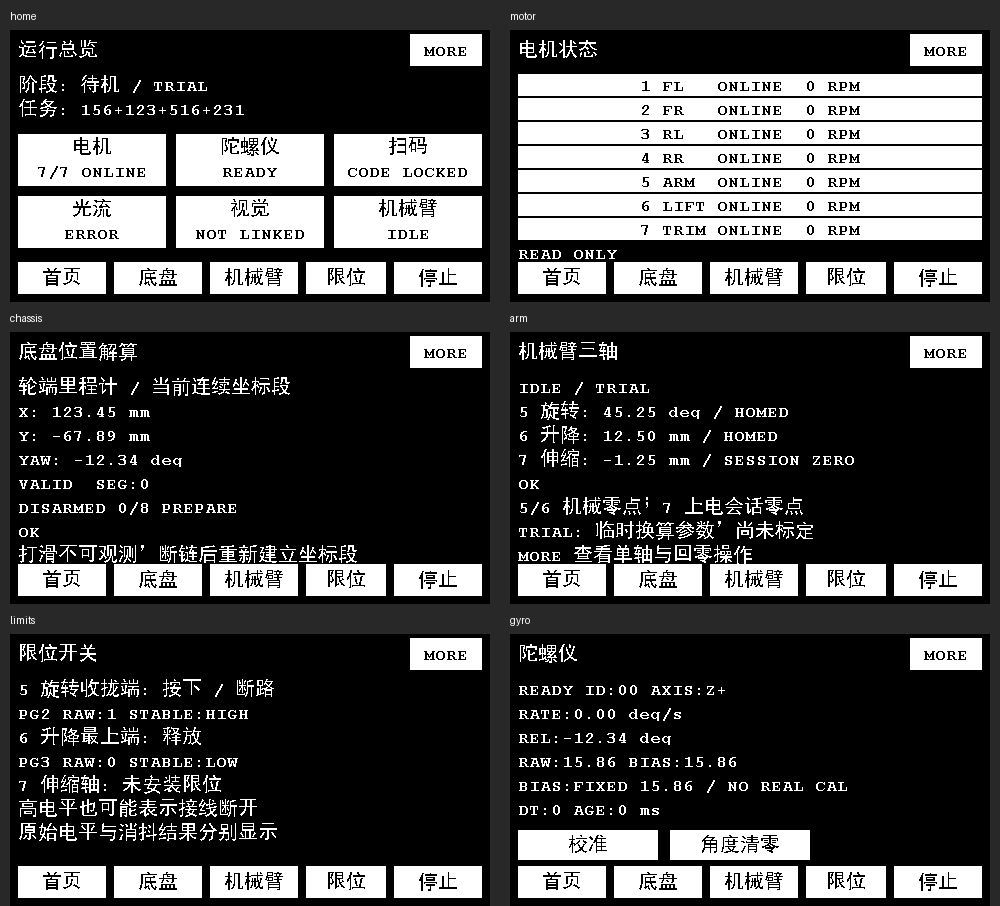

# 2026-10-24 显示界面改版

更新：2026-11-05，按键校准改动基于 main / `f75e0ca`；其余界面说明以 `f14be37` 为核对基线，并纳入后续光流停用改动；按当前 `qr_ui.c` 和 `qr_app.c` 核对当前操作；页面预览与资源数据仍为 2026-10-24 历史记录。早期文档中的 QR 默认页、MOTOR 标题跳转、MANUAL/RUN 测试菜单及旧底栏位置已过时。

## 当前界面

开机进入“运行总览”。上部为真实软件运行阶段及任务码，六个模块卡片显示电机、陀螺仪、扫码、鼠标位移模块、视觉和机械臂。鼠标位移模块显示 NOT LINKED，点击仍留在首页，不设计内页、不初始化或采样硬件。回零显示当前轴号，底盘显示运动状态，不再显示八段段号；停车/故障优先展示。比赛纯调度已接入主循环但执行端为空，K230 协议未实现；比赛页明确显示 `FRAMEWORK ONLY / NO EXECUTOR`，不能启动实车比赛。

所有页面底栏固定为 **首页 / 底盘 / 机械臂 / 限位 / 停止**。模块右上角 **MORE / LESS** 切换详情；无隐藏标题跳转。所有可点击控件均为白色矩形、黑字，背景黑色；动作只在按下边沿触发，按住或滑入按钮不重复触发。

| 页面 | 概览 | MORE |
|---|---|---|
| 首页 | 当前阶段、任务码、六模块状态按钮 | SERVOS 舵机页、RACE FRAMEWORK 比赛框架页入口、总线统计、UI 最大单步耗时 |
| 电机 | 七轴在线/过期/运动/故障/停车状态、RPM，点击行进入该轴 | 单轴累计计数、速度、状态、错误、上一轴/下一轴 |
| 陀螺仪 | 角速度、相对角、RAW/BIAS、校准状态；第六行显示采样时效或无读数原因、操作拒绝提示；校准/角度清零 | ID、采样间隔、GAP、错误与恢复统计 |
| 扫码 | 锁定任务码、串口状态、重新扫码 | 会话、有效/无效/重复帧及错误统计 |
| 鼠标位移模块（仅首页占位） | NOT LINKED，点击不跳转 | 无内页 |
| 视觉 | K230 通信尚未实现 | USART1 引脚及当前波特率；无伪造视觉结果 |
| 底盘 | 持续后台里程计 X/Y/YAW、VALID/SEG、当前动作状态和原因 | 四轮目标/反馈、故障原因、“前进30cm”“后退30cm”两个独立按钮 |
| 机械臂 | 5 号角度、6/7 号毫米位置、零点类型及当前状态 | 点击白色轴标题切换 5/6/7、计数、配置、动作状态、重新回零/机构验收 |
| 限位 | PG2/PG3 原始电平与消抖状态，7 号无开关 | NC 高有效接线、最大采样间隔与最后采样年龄 |
| 舵机（首页 MORE 进入） | JAW/TABLE 的 ON/OFF、输出与目标 μs；夹爪 1700/2430，转盘 PREV/NEXT 选择 1240/1900/2600 | MORE 不增加另一套舵机动作；输出不是实测位置 |
| 比赛框架（首页 MORE 进入） | 未接执行器提示、推定计数/状态、START (NOT READY) | MORE 不改变执行能力；当前 START 始终拒绝 |

2026-11-05 方向核对：前进按钮调用 `Chassis_StartStraightMove(...,+300.0f,...)`，后退调用 `-300.0f`，沿动作开始时的车体局部 X 轴执行。用户确认实测前后方向正确；该确认不扩展为距离精度或保向稳定性通过。

电机页删除 MANUAL、原始使能/速度/脉冲 RUN、四轮 0xAA/SYNC 测试模板和单轴/四轮分散停车入口。固定底栏“停止”统一取消机构/底盘动作及运行中的比赛框架，向七轴请求停车并等待反馈确认，同时关闭两路舵机 PWM、取消待执行的自动启用。MotorBus API、反馈校验、控制权互斥、gyro 校准门控和 STOP 重试策略继续保留。

`MECHANISM_TRIAL_RUN=1` 仍是当前默认。改版没有关闭或重启原上电回零入口（当前为 6→5→配置有效且反馈健康的 7）；首页/机构页标记 TRIAL。机械参数及其假设以 [mechanism_config.h](../User/mechanism/mechanism_config.h) 为准；5/6 回零方向及旋转臂减速比已有用户确认，2026-10-26 用户已实机确认全部 1～7 号电机均为 3200 指令脉冲/电机圈、6 号为 20 齿 × 2 mm＝40 mm/圈；真实底部余量仍未验证，不能把 TRIAL 视为整机标定完成。机构回零/验收和底盘单次直线移动继续受既有配置与反馈条件约束，切页只改显示。

舵机初始化成功后先保持 PWM 关闭；HOME 成功且三轴 HOMED、控制权与总线空闲、无待确认停车时才自动启用初始脉宽。缺少 7 轴不会自动启用。回零等待/忙/停车时 ON 和目标调整被拒绝，OFF 仍可执行；手动 ON 不要求三轴 HOMED。STOP/回零失败取消本次自动启用，后续 HOME 不会重新安排自动启用。CAL/ZERO 均检查机构/底盘控制权，只有 CAL 额外检查电机活动/UNKNOWN/未确认 STOP。

## 倒置与位置含义

- `User/lcd/lcd_orientation.h` 统一定义 `LCD_MOUNT_ROTATE_180=1`。像素、文字、线、矩形、位图在绘图底层旋转 180°，无需整屏复制或额外帧缓冲；矩形先裁剪再映射。
- 触摸驱动保留原始面板坐标；`QrUi_Touch` 转换一次为 `(479-x,271-y)`，再进行点击判定。画面与触摸不能各自重复旋转。
- 底盘展示 `Chassis.odometry` 当前连续坐标段，不是每段动作起点重置的 `data.x_mm/y_mm`。原始里程计在断链后会重新建立坐标段，页面展示 SEG 代数；无效/过期坐标显示 `--`，不能把轮端估计当成真实地面位置，打滑仍不可观测。
- 机械臂必须存在对应参考零点且位置反馈新鲜/在线才显示单位坐标。5/6 号为限位回零，7 号为碰撞回零后建立的中点 HOMED；无零点显示 `--`。7 号过程显示 COLLISION HOME / CENTERING，参数及待验状态见[机构标定记录](MECHANISM_CALIBRATION_TODO_2026-10-25.md)。
- NC 限位高电平显示“按下 / 断路”，未完成消抖显示“采样待稳定”。此接线无法仅靠高电平区分按下和断线。
- 陀螺仪上电/重新初始化后显示 UNCAL / CAL REQUIRED，RATE/REL 为 `--`。静止按“校准”（CAL）采集至少 201 个新样本、满 2 s 后更新偏置，显示 CAL:OK / READY，角度归零；RAW/BIAS 显示原始速率和本次测得偏置。已移除固定补偿及 `BIAS:FIXED` 提示。ZERO 只清角度，不重测偏置。

## 渲染和源码整理

所有页面由 `User/app/qr_ui.c` 统一生成冻结控件快照，按变化控件刷新。每次主循环最多绘制一个 480×4 条带或两个字形；普通刷新至少间隔 100 ms，切页取消未完成作业。中文字模为片内 20×20 精简子集（177 字，约 11 KiB），英文沿用 Font16，扫码大字为 Font24，不依赖外部 SPI 字库。为兼容 AC5 的旧源码字符集，qr_ui.c 使用 GBK 注释及 UTF-8 字节转义字符串，注释保留可读中文。

已删除旧 `motor_ui.*`、`chassis_ui.*`、`mechanism_ui.*` 及对应过时 UI 测试，Keil 工程条目同步清理。单机协议/服务及历史 MotorDemo 回归仍保留。`motor_test_config.h` 仅保留实际使用的总线策略，旧 UI 测试模板宏已移除。

以下预览为 2026-10-24 的生产界面主机渲染存档，未覆盖后来加入的舵机页、比赛框架页及最新回零显示，也仍包含已删除的光流页；此处保留历史图片。数据为合成测试输入，不是实机测量或回零成功证据：



## UI 改版时的历史验证与交付（45087bd）

运行：

```powershell
.\Scripts\test.ps1
.\Scripts\build.ps1 -Rebuild
```

全量主机回归通过，涵盖协议、UART、七轴总线、底盘、机构、扫码、光流、陀螺及新增界面。新 UI 验证 9 页 × MORE/LESS 共 18 种渲染与文字/控件边界、旋转四角/裁剪/触摸、七轴只读页、任务码切页保留、NC 状态、无效坐标、极值计数、动作边沿、重复 START、配置/校准拒绝、全局 STOP 和 TRIAL 首页自动回零。

注入慢 LCD 的正常/固定补偿两组应用测试中，UI 单步最大 2 ms，STOP 至 transport.send 为 13/7 ms，gyro 最大轮询 3 ms，触发相位抖动 0 ms；故意将原语延迟至 12 ms 仍能检测到角度 GAP。这些仅为指定主机成本模型结果，不是板上耗时或机械停车时间。日志在 `Output/dashboard-tests.log`。

Keil LCD / AC5 全量构建 **0 错误、0 警告**。Code / RO / RW / ZI = **87356 / 30636 / 1688 / 22376 字节**；静态 app = **13456 字节**；链接器静态栈分析 **1752 字节 + 未知项**，配置栈仍为 4096 字节，不等同实测栈高水位。固件为 `Output/YH-F429.hex`，构建日志为 `Output/ui-build.log`。

该 UI 改版交付当次未烧录。2026-11-04 用户已确认屏幕八段及机构回零功能测试完成，但未提供 UI 专项验收结果；仍需核验倒装后的方向、四角与按钮点击位置、刷新/触摸期间 gyro 连续性、运动中 STOP 及反馈确认。比赛要求的实际字高仍需用尺测量，本次未将 20/24 像素字形宣称为 12 mm 合规显示。

预览可用 Pillow 重新生成：先执行主机测试，再运行 `Scripts/render_ui_preview.py`。字模已随源码保存，无需重新生成；新增中文标签时运行 `Scripts/generate_ui_font.py --font <本机字库路径>`。本次使用本机 `C:/Windows/Fonts/simhei.ttf` 生成静态子集，脚本不下载字库。

2026-11-04 光流停用后，应用共 10 页、20 种 MORE/LESS 渲染状态；鼠标位移卡片不是独立页面。原字模保持不变，新标签缺字使用本机 `/System/Library/Fonts/STHeiti Medium.ttc` 补充；`--keep-existing` 可保留仍使用的已有字形并剔除不再使用的字形。

### 2026-11-04 光流停用改动验证

在 macOS 使用 Clang C11、`-Wall -Wextra -Werror`（仅忽略现有 GBK 注释的源码编码警告），按 `Scripts/test.ps1` 的应用源文件列表构建正常 CAL、固定补偿、默认 TRIAL 三种配置，全部未链接光流源码或替身。应用/扫码、初始化与 DMA 故障、动作仲裁、七轴 STOP、自动回零及 10 页 × MORE/LESS 的 20 种界面渲染检查通过；新增鼠标位移卡片和旧 CLEAR 区域点击测试，确认留在首页且不派发动作。首页合成帧已人工检查，六字标签完整显示。此轮未运行 Windows MSVC/Keil 构建，也未烧录实机。

现有慢屏模型的完整页面遍历通过，固定补偿模式记录 UI 单步 2 ms、STOP 5 ms、gyro 最大轮询 3 ms。另发现既有时序边界：将 `Tests/test_qr.c` 的 `test_timing` 遍历上限临时改为 `UI_SERVO`（停在舵机页），固定补偿模式可出现 15 ms 样本间隔并触发 GAP。修改前 `00632b8` 在相同切页序列（跳过旧光流页）也复现，属于已有 gyro 配置巡检/采样调度问题，光流停用当次未处理；后续修复见下节。上述通过结果不代表任意刷新相位均无 GAP，更不代表实机时序验收。

### 2026-11-04 gyro 调度与诊断修复

`last_poll` 仅在准备执行 `Icm_Fetch` 时更新；250 ms 配置巡检没有读取 DRDY，不再消耗下一次采样的 2 ms 轮询额度。继续保留 10 ms 轮询空档、14 ms 样本间隔、30 ms 新鲜度保护，以及 GAP 后需显式 ZERO/CAL 建立新角段的行为。

陀螺普通页第六行正常时显示 DT/AGE，初始化时显示 INIT，异常时显示 ERR 和当前 BUS（OK/NACK/TIMEOUT/BUSY/IO）。该行位于动作按钮上方，不新增第七行而与按钮重叠。ZERO/CAL 因机构或底盘占用被拒绝时，同一行显示 `ZERO/CAL REJECT: MECHANISM/CHASSIS BUSY`；ZERO 因数据或校准状态不满足也会提示。操作拒绝提示优先于该行诊断，下一次 CAL/ZERO 操作或切页清除；MORE 仍可查看诊断。按键只请求下一次控件快照刷新，不强制整页清屏。

MORE 的 LAST 表示最近一次传感器/连续性故障，LBUS 是最近一次非 OK 的 I2C 错误，成功通信或自动重初始化后仍保留；两者各自记录，未必来自同一次故障。重新初始化整个应用时清零。

验证：Clang C11 严格警告下，正常 CAL、固定补偿和 TRIAL 应用配置通过；三种轴映射的陀螺服务测试分别通过 41019 次检查。新增 `timing-servo`、`timing-home` 复现相位，纳入默认 Windows 测试脚本；原完整页面时序与新增两种相位均通过，故意注入超预算 LCD 耗时仍检出 GAP。覆盖机构/底盘占用拒绝、恢复后 ZERO、I2C 无数据提示、旧提示清除、最近总线错误保留及错误/GAP/拒绝/恢复四种诊断渲染。未运行 Keil/MSVC，也未烧录实机。

用户反馈上电偶发无示数、复位或重新上电恢复，但尚无当时页面状态记录。此次修复已定位的调度问题并增强诊断，没有加入 I2C 总线解锁或更改初始化/重试参数；不能据此宣称所有上电无读数问题已解决。
